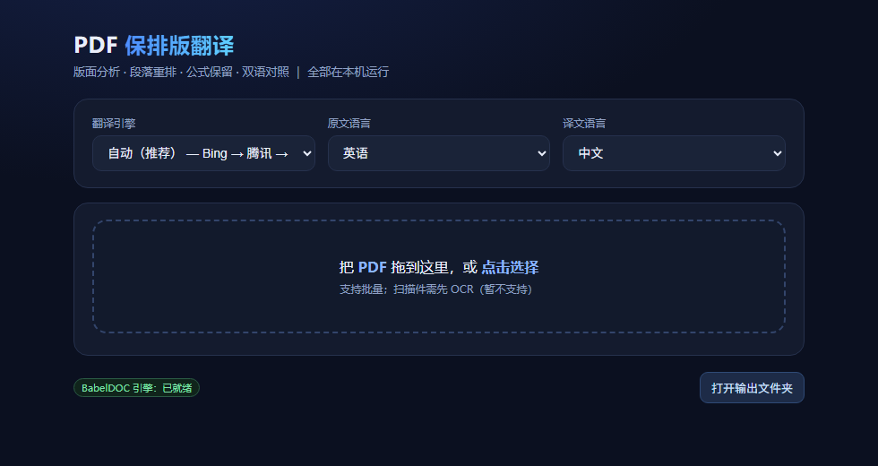

# PDF翻译专家（PDF Layout-Preserving Translator）

当前版本：**v1.1.2**

> 拖入 PDF → 版面分析 → 翻译 → **保留原排版**输出。纯本地运行，可离线（本地引擎），也可接入免费翻译通道。



## 特性

- **保排版**：按原文的段落框、字号、颜色回填译文，双栏 / 图表 / 页眉页脚位置不变
- **公式保留**：公式区不参与机翻，数学字形原样保留；行内公式做 Unicode 归一化，避免丢字符和方块字
- **软件内一键安装**：BabelDOC 引擎/腾讯引擎都能在界面里装，不需要命令行
- **多引擎**
  | 引擎 | 说明 |
  |---|---|
  | BabelDOC + Bing | 快，默认 |
  | BabelDOC + 腾讯（免费） | **无需账号**，国内网络可用（需要打补丁，见下） |
  | BabelDOC + Google | 备用通道 |
  | BabelDOC + 大模型 | 译文更自然，较慢 |
  | 本地引擎 | 零外部依赖，只用 PyMuPDF |
- **双语对照**：输出「纯译文」和「左右对照」两个 PDF
- **批量**：多文件排队，逐个显示进度
- **无控制台窗口**：双击即用，全程网页界面

## 小白版：三步就能用

1. 下载 `PDF-Translator-v1.0.1.exe`，双击
2. 拖入 PDF（英文文献），引擎保持「自动」
3. 完成后点「下载纯译文」

想排版更好？在界面里点 **「一键安装 BabelDOC」**——软件内自动创建独立环境并安装（约 300~500MB，3~15 分钟，走国内镜像），装完自动出现「BabelDOC + 腾讯 / Bing」引擎选项。**不装也能用**（本地引擎）。

## 直接用（Windows）

双击 **`PDF翻译专家.exe`** —— 原生窗口，无浏览器、无命令行。

- 拖入 PDF（支持批量）→ 选引擎 → 完成即出现下载按钮
- **输出目录可改**：界面里「输出目录 → 更改」选一个文件夹即可（记住设置，重启不丢），默认是 exe 同目录的 `译文输出\`

## 从源码运行

```bash
pip install -r requirements.txt
python pdf_translator_desktop.py     # 桌面窗口
python pdf_translator_app.py         # 或纯网页模式 http://127.0.0.1:8910
```

## 自己打包 exe

```bat
build_exe.bat
```

产物：`dist\PDF翻译专家.exe`（单文件，约 60MB）。

## 可选：启用 BabelDOC 引擎（排版更好）

1. 安装 [pdf2zh_next](https://github.com/PDFMathTranslate/PDFMathTranslate)（BabelDOC 内核），
   或使用现成整合包，保证目录下有 `env/python.exe` 与 `app/config/config.toml`
2. 设置环境变量指向该目录：

```bat
set PDF2ZH_HOME=D:\PDF_Translator
```

3. （可选）安装**腾讯免费翻译**插件：

```bat
%PDF2ZH_HOME%\env\python.exe install_tencent_free.py
```

   插件是幂等的：写入 `translator_impl/tencentfree.py` 并在
   `config/translate_engine_model.py` 注册引擎；升级 pdf2zh_next 后重跑一次即可。

   之后命令行也能直接用：

```bat
pdf2zh_next input.pdf --tencentfree --lang-in en --lang-out zh
```

没有 BabelDOC 时工具自动只用本地引擎，功能不受影响。

## 工作流程

```
PDF ──► 版面分析(pymupdf_layout / BabelDOC)
     ──► 段落 + 行内公式归组
     ──► 翻译（可插拔服务）
     ──► 回填：先算字号（放不下就缩小/扩框，绝不重叠）
     ──► 纯译文 PDF + 左右对照 PDF
```

## 已知限制

- **扫描件**（纯图片 PDF）不支持，需要先做 OCR
- 表格按单元格翻译，行高不随中文变宽自动拉伸，密集表格可能偏挤
- 参考文献整节默认跳过（机翻条目基本不可读）
- 免费翻译通道有速率限制，长文档偶发个别段落回落原文

## 目录结构

```
pdf_translator_app.py    Web 服务 + 界面（批量、进度、下载）
pdf_translate.py         本地引擎：版面分析 / 翻译 / 回填 / 双语对照
babeldoc_engine.py       BabelDOC 引擎适配器（可插拔服务）
install_tencent_free.py  给 pdf2zh_next 安装腾讯免费引擎（幂等）
```

## 许可证

AGPL-3.0。本项目使用的 PyMuPDF / pymupdf4llm / BabelDOC 均为 AGPL-3.0，
因此本项目同样以 AGPL-3.0 发布。


## 常见问题（换电脑安装用不了先看这里）

| 现象 | 原因 | 处理 |
|---|---|---|
| 双击后窗口一闪而过 / 没反应 | 系统缺 **WebView2 运行时**（Win10 早期版本常见） | 装一次即可：https://go.microsoft.com/fwlink/p/?LinkId=2124703 ；未安装时程序会自动改用浏览器打开同一界面 |
| 译文全是方块 / 空白 | 系统没有中文字体（英文版 Windows、精简系统） | v1.0.1 起已内置 CJK 字体兜底，无需处理；旧版请升级 |
| 提示输出目录不可写 | 程序放在 Program Files 等受限目录 | 自动改用 LOCALAPPDATA\\PDF翻译专家\\译文输出，也可手动改输出目录 |
| 右上角显示「BabelDOC 引擎：未安装」 | 只装了主程序，没装 BabelDOC | 正常，本地引擎可用；想要更好排版再装 pdf2zh_next |
| 杀毒软件拦截 | exe 未做代码签名 | 添加到信任列表即可（源码全部公开，可自行编译） |
| 翻译很慢 | 用了「免费大模型」通道 | 换「BabelDOC + Bing」或「自动」 |
